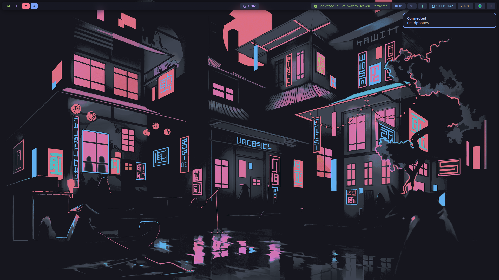
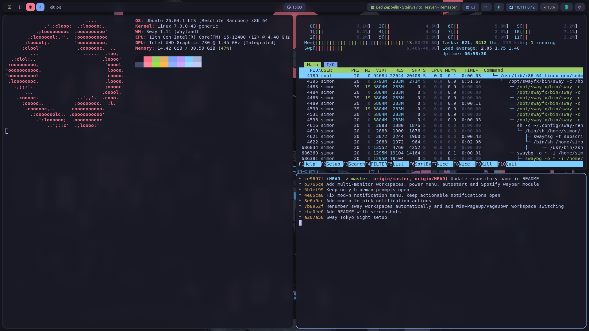
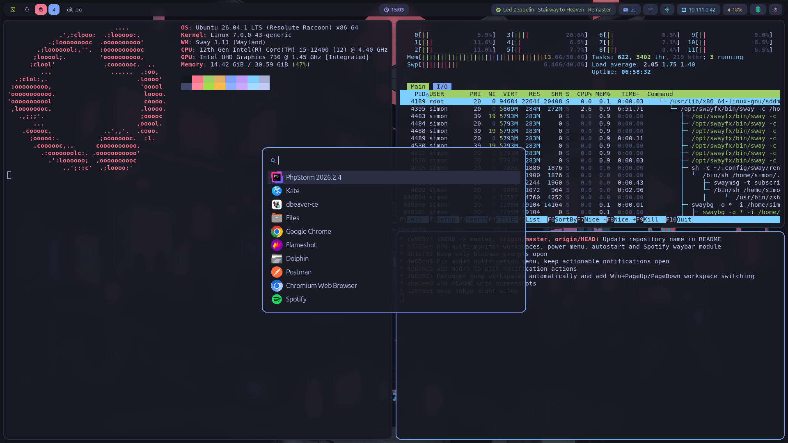
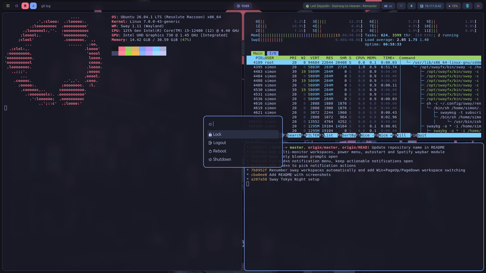

# sway-tokyo-night



**Tokyo Night on sway for Ubuntu. Floating pill bar, every app themed, and each monitor gets its own workspace 1, 2, 3.**

| | |
|---|---|
| **OS** | Ubuntu 26.04 |
| **WM** | Sway 1.11 (screenshots taken on SwayFX, which is optional) |
| **Bar** | waybar |
| **Launcher / menus** | fuzzel |
| **Terminal** | foot |
| **Notifications** | mako |
| **Lock screen** | gtklock (a themed swaylock config is included too) |
| **Fonts** | Ubuntu + Symbols Nerd Font (the Nerd Font symbols are bundled in `fonts/`) |
| **Wallpaper** | [alchem1no/tokyonight-wallpapers](https://github.com/alchem1no/tokyonight-wallpapers) |

## Screenshots

Three foot windows tiled: fastfetch, htop, and the git log of this repo.



`Super+d` opens fuzzel. Snap apps show up in the list too.



`Super+Shift+e` (or the power button on the bar) opens the power menu.



## Install

Ubuntu only, the script uses apt.

```sh
git clone https://github.com/SimonZanta/sway-tokyo-night.git
cd sway-tokyo-night
./install.sh
```

`install.sh` installs sway, swaybg, waybar, mako, fuzzel, foot, gtklock, swaylock, blueman, network-manager-gnome, pulseaudio-utils, playerctl, brightnessctl, grim, jq and the Ubuntu font. It then copies `config/` into `~/.config`, puts the Nerd Font symbols into `~/.local/share/fonts`, and reloads sway and mako if sway is already running.

**It overwrites your existing configs** for those apps. No backup is made, so copy your `~/.config` folders somewhere first if you care about them.

## Things you need to change

This is my actual setup, so a few bits are personal. After installing:

| What | Where | Why |
|---|---|---|
| Autostart | `~/.config/sway/autostart.sh` | On login it opens two foot terminals, DBeaver, Google Chrome and Spotify (snap) and drops each one on its workspace. Edit it or delete it. |
| Monitor names | `~/.config/sway/config` | Workspaces 1-3 of the left monitor are pinned to `HDMI-A-2`, the right monitor to `HDMI-A-1`. Run `swaymsg -t get_outputs` and put your own output names in. |
| Keyboard layout | `~/.config/sway/config` | `us` + `cz` (qwerty), switched with `Alt+Shift`. Change `xkb_layout`. |

## Workspaces per monitor

This is the part I'd miss most on any other setup.

Monitors are counted left to right, and `Super+1` takes you to workspace 1 **of the monitor you're on**. So the left screen has its own 1, 2, 3 and the right screen has its own 1, 2, 3. No more workspace 7 ending up on the wrong display.

The first three on each monitor are fixed and get their own icon and colour in the bar:

| | 1 | 2 | 3 |
|---|---|---|---|
| **Left monitor** | terminal (green) | code (purple) | database (yellow) |
| **Right monitor** | web (blue) | music (teal) | document (orange) |

Need more? `Super+t` opens the next free one (4, 5, ...) on the current monitor, and `Super+Shift+t` sends the focused window to a new one. When a workspace from 4 up closes, the rest renumber themselves so there are never gaps.

Under the hood they're named like `21:1` (monitor 2, workspace 1), but the bar only shows the number or the icon.

## The bar

Floating waybar at the top, rounded and slightly see-through, with every module in its own pill.

**Left**
- **Workspaces**: icons and colours as above. Focused is a blue pill, urgent is red.
- **Sway mode**: an orange pill when you're in a mode like resize.
- **Window title**: the focused window, cut at 50 characters.

**Centre**
- **Clock**: `HH:MM`, click to flip to the date (`Mon 20.11.2026`), hover for a month calendar with week numbers and today in red.

**Right**
- **Spotify**: `artist - title` of what's playing, via playerctl. Spotify only.
- **Keyboard layout**: `us` / `cz`, click to switch.
- **VPN**: the active VPN name in green, or a dimmed icon when off. Left click opens nm-connection-editor. Right click disconnects the active VPN, or connects the first one set up in NetworkManager and asks for the password in a small floating foot window.
- **Bluetooth**: the icon, or the connected device with its battery %. Hover lists connected devices, left click opens blueman-manager, right click turns Bluetooth on or off.
- **Network**: IP on ethernet, SSID on wifi, red `offline` when there's nothing. Hover shows interface, IP/CIDR, gateway and live up/down speed. Click opens nm-connection-editor.
- **Volume**: icon + %, switches to a headphone icon on headphones. Scroll for 5% steps, click to mute.
- **Tray**: blueman applet and friends.
- **Power**: same menu as `Super+Shift+e`.

## Shortcuts

`Super` is the Windows key.

### Added by this setup

| Keys | Does |
|---|---|
| `Super+d` | App launcher (fuzzel, includes snap apps) |
| `Super+Shift+e` | Power menu: Lock, Logout, Reboot, Shutdown |
| `Super+l` | Lock screen (gtklock) |
| `Super+n` | Pick an action from a notification |
| `Super+1` ... `Super+0` | Go to workspace N on this monitor |
| `Super+Shift+1` ... `Super+Shift+0` | Move window to workspace N on this monitor |
| `Super+t` | New workspace on this monitor |
| `Super+Shift+t` | Move window to a new workspace |
| `Super+PageUp` / `Super+PageDown` | Previous / next workspace |
| `Super+Ctrl+Shift+Left` / `Right` | Focus the monitor to the left / right |
| `Alt+Shift` | Switch keyboard layout (us / cz) |
| `Print` | Full screenshot with grim (no notification) |
| Media keys | Volume, mic mute, play/pause/next/prev/stop, brightness. These work on the lock screen too. |

Heads up: **`Super+l` locks the screen instead of focusing right.** Use `Super+Right` to focus right. `Super+Shift+l` still moves the window right.

### Standard sway keys (kept)

| Keys | Does |
|---|---|
| `Super+Return` | Terminal (foot) |
| `Super+Shift+q` | Close window |
| `Super+h/j/k` or arrows | Move focus |
| `Super+Shift+h/j/k/l` or arrows | Move window |
| `Super+b` / `Super+v` | Split horizontal / vertical |
| `Super+s` / `Super+w` / `Super+e` | Stacking / tabbed / toggle split |
| `Super+f` | Fullscreen |
| `Super+Shift+space` | Toggle floating |
| `Super+space` | Switch focus between tiling and floating |
| `Super+a` | Focus parent |
| `Super+Shift+minus` / `Super+minus` | Send to / show scratchpad |
| `Super+r` | Resize mode (h/j/k/l or arrows, Enter or Esc to leave) |
| `Super+Shift+c` | Reload config |
| `Super` + left drag / right drag | Move / resize window |

## Notifications and lock screen

**mako** sits top right: 360px wide, rounded, blue border, gone after 5 seconds. Critical ones get a red border and stay until you dismiss them. Blueman prompts that need an answer (pairing and so on) also stay put. `Super+n` lets you pick a notification action in fuzzel.

**gtklock** gets the Tokyo Night background, a big 72px blue clock, a rounded password field and a blue unlock button.

## SwayFX (optional)

The screenshots are from [SwayFX](https://github.com/WillPower3309/swayfx). `install.sh` only installs plain sway, and everything works fine there. If you install SwayFX yourself, there's an extra config with blur, shadows, 10px rounded corners, animations and a blurred bar:

```sh
sway -c ~/.config/sway/config-fx
```

## Colours

Straight Tokyo Night:

| | |
|---|---|
| Background | `#1a1b26` |
| Text | `#c0caf5` |
| Blue | `#7aa2f7` |
| Purple | `#bb9af7` |
| Green | `#9ece6a` |
| Yellow | `#e0af68` |
| Red | `#f7768e` |
| Teal | `#73daca` |

## Credits

Wallpaper from [alchem1no/tokyonight-wallpapers](https://github.com/alchem1no/tokyonight-wallpapers) (Unlicense). Colours from the Tokyo Night theme.

If you end up using this, a star helps other people find it.
